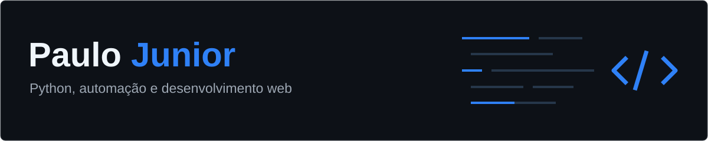

  

Sobre mim
Sou Paulo Junior, estudante de Engenharia de Software na UFMS. Atuo na área de tecnologia da Nabarrete e Ferro, desenvolvendo sistemas e automações para apoiar as rotinas da empresa.

No dia a dia, trabalho com Python, Django, JavaScript e PostgreSQL, desde a criação de funcionalidades até a manutenção e melhoria das soluções em uso.
Minha atuação na Nabarrete e Ferro
- Desenvolvimento e manutenção de aplicações web e ferramentas internas.
- Automação de tarefas repetitivas e rotinas operacionais com Python e Selenium.
- Integração entre sistemas e APIs para coleta e troca de informações.
- Consultas SQL, organização e armazenamento de dados com PostgreSQL.
- Criação de dashboards e relatórios para acompanhamento da operação.
- Investigação de falhas e melhorias nos processos e sistemas utilizados pela equipe.
Tecnologias e ferramentas

  
  
  
  
  

  
  
  
  
  
  

O que eu desenvolvo
Automação de processos	Aplicações web	Integrações e dados
Scripts e robôs com Python e Selenium para tarefas repetitivas.	Sistemas, dashboards e relatórios com Django e JavaScript.	Integração entre sistemas, consultas SQL e persistência com PostgreSQL.
